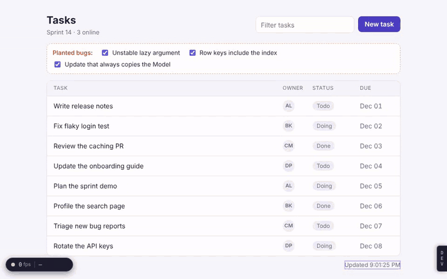

# foldkit-scan

See what re-renders in your [Foldkit](https://github.com/foldkit/foldkit) app, and why.



- **Flashes every patch** on the page, labelled with the view function and the Message that caused it.
- **Times every frame**: update, view and patch, straight from Foldkit's own `slow` hook.
- **Finds the usual suspects**: updates that copy an unchanged Model, lazy views that never hit, and keyed lists rebuilt on every render. Each issue comes with the fix.
- **Reaches your other tools**: Commands on a timeline, tracks in Chrome's Performance panel, and an MCP server for AI agents.
- **Stays out of the way**: one small pill in a corner, a panel when you want it, and nothing at all in production.

## Quickstart

```sh
pnpm add -D foldkit-scan
```

Create one instance, then hand Foldkit its `view` and `slow` hooks:

```ts
import { Runtime } from 'foldkit'
import { Scan } from 'foldkit-scan'

const container = document.getElementById('root')

const scan = Scan.make<Model, Message>({
  enabled: import.meta.env.DEV,
  container,
})

const application = Runtime.makeApplication({
  Model,
  init,
  update,
  view: scan.view(view),
  slow: scan.slow,
  container,
})

Runtime.run(application)
```

That's it. Open the panel with the pill or <kbd>Alt</kbd>+<kbd>Shift</kbd>+<kbd>S</kbd>.

To see hits and misses for a lazy view, wrap its slot:

```ts
import { createKeyedLazy } from 'foldkit/html'

const rowSlot = createKeyedLazy()
const lazyRow = scan.keyedLazy('Row', rowSlot)
```

## More

**Commands.** Pass `resources: scan.resources` to `makeApplication` and the panel shows each Command, how long it took and the Message it returned. If you already have resources, use `Layer.merge(AppResources, scan.resources)`.

**Chrome's Performance panel.** Record a profile and update, view, patch and Commands appear on their own foldkit-scan tracks.

**AI agents.** Add the Vite plugin, then point your agent at the MCP server. It can ask for issues, a summary or the full report.

```ts
// vite.config.ts
import { foldkitScan } from 'foldkit-scan/vite'

export default defineConfig({ plugins: [foldkit(), foldkitScan()] })
```

```json
{
  "mcpServers": {
    "foldkit-scan": { "command": "npx", "args": ["foldkit-scan-mcp"] }
  }
}
```

Agents that drive a browser can also call `window.__FOLDKIT_SCAN__.report()`.

**DevTools link (experimental).** `foldkitScan({ experimentalDevToolsLink: true })` adds a button to each frame that pauses Foldkit DevTools on its Message. It relies on a Foldkit internal, so it may break on an upgrade.

## Try it

The [example](example/) is a small task list with three performance bugs planted on purpose. Switch them on and off and watch the panel. "Add 1,000" makes the page big, "Save" runs a Command, and `?scan=off` in the URL turns foldkit-scan off to compare.

```sh
pnpm install
pnpm dev
```

## License

MIT
